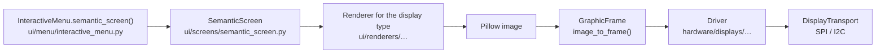

# Adding a display

This guide shows how a new display module gets into the player: a driver,
a test program for the hardware, a renderer for the player's screens, and
finally the connection to the display service. The SH1107 (128×64, mono)
and ST7735S (160×128, color) went through the first steps. SSD1351 is a
complete configuration-selected 128×128 RGB example; see [Displays](DISPLAYS.md).

## How the display output works



- **What** is shown is decided once, for every display: the menu builds a
  `SemanticScreen` with the heading, rows (`ScreenItem`), focus, message,
  status and footer, already translated. A small display may leave out
  optional lines.
- **How** it looks is the renderer's job, one per display type:
  `oled_128*.py` shared by the 128×128 SSD1327 and SSD1351, `compact_128x64.py` for 128×64,
  `landscape_160x128.py` for 160×128, `character_*.py` for character LCDs.
- The **driver** only turns an image into bytes and sends them over a
  `DisplayTransport` (SPI or I2C, `hardware/displays/transport.py`).

**Runtime selection:** `hardware/displays/runtime.py` explicitly registers
SSD1327 and SSD1351. The service reads `[display]` and shares the 128×128
rendering pipeline, while backend adapters provide pixel packing, current
control and I/O recovery. A new geometry also needs its renderer connected;
a standalone diagnostic or catalog profile alone does not make it selectable.

## 1. Driver

Create `src/sonoscdplayer/hardware/displays/<controller>.py`, e.g. based on
`sh1107.py`:

```python
@dataclass(frozen=True)
class DisplayConfig:
    rotation: int = 0          # what the module needs: rotation, offsets, color order …

    @property
    def size(self):            # logical (width, height) after rotation
        ...

    @property
    def capabilities(self):    # DisplayCapabilities: kind, size, pixel format
        ...


def image_to_frame(image, config=DisplayConfig()):
    """Pillow image of config.size -> GraphicFrame in the controller's format."""


class MyController:
    def __init__(self, transport: DisplayTransport, config=DisplayConfig(), *, sleep=time.sleep):
        ...

    def open(self):            # transport.open(), reset, init sequence, display on
    def show(self, frame):     # write the frame
    def close(self):           # display off, transport.close()
```

Rules that keep it testable and safe:

- Import no hardware library at module level; the transport opens SPI/I2C
  and GPIO in `open()`.
- Take `sleep` and the transport as arguments, so tests can replace them.
- Keep the controller's init sequence in one place with a comment for each
  command, and name the datasheet in the module docstring.

## 2. Test program

Create `<controller>_test.py` next to the driver, like `sh1107_test.py`:
test patterns (border, grid, text, gradients), `--preview-dir` to write the
patterns as PNG without hardware, and `--gpio --execute` to show them on
the module. Default pins and options should match the tested wiring.

```sh
cd src
python3 -m sonoscdplayer.hardware.displays.<controller>_test --preview-dir /tmp/preview
sudo systemctl stop sonoscdplayer-oled.service    # never two programs on one display
python3 -m sonoscdplayer.hardware.displays.<controller>_test --gpio --execute
```

Write down what you confirmed on the hardware (rotation, offsets, color
order, pins) in `docs/<CONTROLLER>.md`.

## 3. Renderer

If an existing renderer fits the size and color depth, use it. Otherwise
add `src/sonoscdplayer/ui/renderers/<layout>.py` with a class that draws a
`SemanticScreen`:

```python
class MyRenderer:
    def render(self, screen: SemanticScreen, *, elapsed=0):
        """Pillow image of the display's size; ``elapsed`` drives scrolling text."""
```

Draw every `screen.kind` (`idle`, `playback`, `menu`, `notice`). Use
`ui/menu/marquee.py` for text that does not fit, and keep the focused row
visible (see `menu_window()` in `compact_128x64.py`).

## 4. Profile

Add the module to `PROFILES` in `src/sonoscdplayer/ui/displays/profiles.py`
(key, controller, size, color mode, whether covers are shown in mode
`auto`, refresh policy). A module that was tried and is not suitable goes to
`REFERENCE_PROFILES` instead, so it is never offered.

## 5. Tests

Under `tests/hardware/displays/` and `tests/ui/`:

- **Driver:** a recording transport (see `RecordingTransport` in
  `test_sh1107.py`) checks the init sequence, the bytes of a frame and that
  `close()` turns the display off and releases the bus.
- **Frame conversion:** `image_to_frame` for each rotation, wrong image
  sizes rejected.
- **Renderer:** render the sample screens from
  `tests/helpers/display_samples.py` and check bounds, focus and scrolling.

No test may need the real display.

## 6. Connecting it to the display service

SSD1351 implements this step for the shared 128×128 layout. For another module:

1. `[display] controller` (and its options) accepted for the new module in
   `hardware/displays/pins.py`.
2. Register its backend factory in `hardware/displays/runtime.py`. Reuse the
   shared 128×128 image path where possible; connect a geometry-specific
   renderer for other sizes, including every menu/notice/setup screen.
3. Contrast or backlight brightness from the ambient light, if the module
   supports it.
4. The shutdown screens (`src/native/shutdown/backends/`) for the new
   controller, or a decision that the module shows none.

Please open an issue before starting this part, so that the selection
works the same way for every display.
