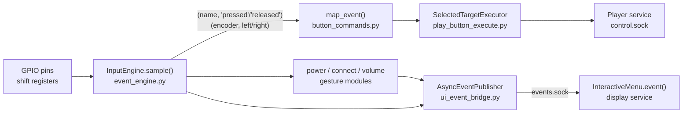

# Adding buttons and input modules

All physical inputs are read by one process, the button service
(`hardware/inputs/button_service.py`). This guide shows how inputs are
configured, how to add another button, and how to read buttons through an
input module instead of direct GPIO pins.

## How an input becomes an action



1. Every 2 ms (`[gpio] poll_interval_ms`) the service reads all levels:
   direct GPIO pins and every configured shift register.
2. `InputEngine` debounces each button and decodes the rotary encoder. It
   returns events like `('stop', 'pressed')` or `('encoder', 'right')`.
3. **Playback buttons** go through `map_event()` to one player command per
   press. The `SelectedTargetExecutor` reads the player status and the
   selected speaker, plans the safe command (`play_button_policy.py`) and
   sends it to the player. Only the commands in `SAFE_COMMANDS` can be sent
   this way.
4. **POWER, CONNECT and volume** have their own gesture logic (long press,
   repeat while held) in `power_gesture.py`, `connect_gesture.py` and
   `volume_buttons.py`.
5. **Menu inputs** (encoder, encoder push, POWER, CONNECT, speaker button,
   volume feedback) are sent as small datagrams to the display service,
   which passes them to `InteractiveMenu.event()`. Only pairs in
   `ui_event_bridge.ALLOWED` are sent; everything else is dropped. Events
   are best effort: if the display service is busy or not running they are
   lost, never queued.

## Configuration

Inputs are configured in `interface.toml` (example:
`config/interface.example.toml`). Each button in `[buttons]` is either a BCM
pin number or a shift register channel `"<register>:<index>"`:

```toml
[buttons]
power = 17
stop = "front:3"          # bit 3 of shift register "front"
speaker_select = -1       # not installed

[shift_registers.front]
type = "74hc165"
load_pin = 23
clock_pin = 24
data_pin = 25
chips = 1                 # cascaded chips, 1..8 (8 inputs each)

[input_defaults]
pull = "off"              # off | up | down (direct GPIO only)
active_level = "high"     # high | low
debounce_ms = 0

[button_overrides.stop]   # per-button exceptions
active_level = "low"
debounce_ms = 30
```

The configuration is checked completely at start: unknown buttons, a pin
used twice, a channel outside the register or `pull` on a register input
stop the service with a clear error.

## Adding a button

Example: a new `repeat` button that sends a new player command.

1. **Name.** Add `'repeat'` to `BUTTON_NAMES` in
   `hardware/inputs/event_engine.py`.
2. **Optional or required.** Every name in `BUTTON_NAMES` must be in
   `[buttons]`, except `speaker_select`, which may be missing or `-1`.
   A button that existing players do not have must be optional the same
   way, or every existing `interface.toml` stops working after the update.
   Add it to the example config (commented out or `-1`).
3. **Player command.** Map it in `PRESS_COMMANDS`
   (`hardware/inputs/button_commands.py`). If the command is new, the
   player must accept it (`handle_command` and `COMMANDS` in
   `player/service.py`), and the button service must allow it: add it to
   `SAFE_COMMANDS` and give it a plan in `play_button_policy.py` that
   decides from the current status whether the command makes sense, and to
   the allowed commands in `handle_event()` (`button_service.py`).
4. **Wake the drive.** Every physical press already counts as activity and
   wakes a sleeping drive in the background. For commands sent through the
   safe executor the wake happens before the command instead; add the new
   command to the tuple in `should_publish_drive_activity()`
   (`button_service.py`) so it is not woken twice.
5. **Menu instead of player?** For a button that only changes the display
   (for example "next menu page"), skip step 3: add `('repeat', 'pressed')`
   to `ALLOWED` in `ui/menu/ui_event_bridge.py` and handle it in
   `InteractiveMenu.event()` (`ui/menu/interactive_menu.py`).
6. **Docs.** Mention the button in the README hardware section and
   in [Configuration](CONFIGURATION.md).
7. **Tests.** In `tests/hardware/inputs/`: `map_event` gives the command
   (`test_input_commands.py`), the config accepts a missing button and
   rejects a duplicate pin (`test_input_core.py`), and the safe executor
   sends the planned command (`test_input_safe_buttons.py`). For menu
   buttons, a test in `tests/ui/test_ui_events.py`.

## Adding an input module

A module gives more inputs on few GPIO pins. The 74HC165 shift register is
the existing example (`hardware/inputs/shift_register_74hc165.py`):

```python
class ShiftRegisterReader:
    def __init__(self, gpio, registers): ...
    def setup(self):   # configure the pins once
    def sample(self):  # read all inputs now -> {"front:0": 1, "front:1": 0, ...}
```

The engine never sees the module: it only gets a dictionary of levels, keyed
by BCM pin for direct inputs and by `"<name>:<index>"` for module inputs.
That makes a new module (for example an I2C port expander) a small change:

1. **Reader.** A class with `setup()` and `sample()` like the one above.
   `sample()` must read every input in one go and quickly; it runs every
   poll interval.
2. **Config.** A new `type` under `[shift_registers.<name>]` with its own
   keys, checked in `_registers()` in `event_engine.py`. Channels keep the
   `"<name>:<index>"` form, so `[buttons]` does not change.
3. **Wiring.** In `run_gpio()` (`button_service.py`), create the reader for
   the configured type and merge its `sample()` into the levels, as is done
   for the shift registers.
4. **Tests.** A fake GPIO or bus that records the calls and returns given
   bits; check the bit order and that the channel names match
   (`test_input_core.py` has the 74HC165 tests to copy).

## Rotary encoder

There is one encoder (`[encoder]`: A, B and the push switch), decoded in
`InputEngine.sample()` as a quadrature state machine.
`[encoder_input] steps_per_detent` sets how many valid transitions make one
step (1, 2 or 4), and `invert_direction` swaps left and right. The encoder
pins must be direct GPIO pins: a shift register read every 2 ms is fast
enough for buttons, but can miss encoder transitions when it is turned
quickly.

A second encoder (for example for volume) is not supported yet. It would
need its own config table, its own event name (not `encoder`), an entry in
`ALLOWED` and handling in the menu or the volume logic.
