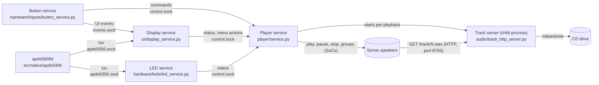

# Architecture

A short tour of how SonosCDPlayer is put together, for anyone who wants to
change or extend it. The code reference (every module, class and function)
is built from the docstrings with `tools/build_api_docs.sh`.

## Processes

The player is a handful of small services on the Raspberry Pi. Each one has
a single job; they talk to each other only through local Unix sockets.

| Service | systemd unit | Job |
|---|---|---|
| Player | `sonoscdplayer-player.service` | Owns the drive and the Sonos playback. Reads the CD, starts the track server, sends PLAY/PAUSE/STOP to Sonos, forms and releases groups, fetches metadata. Answers JSON commands on `/run/sonoscdplayer/control.sock`. |
| Track server | (child of the player) | Reads one track (or the whole disc) with cdparanoia into a RAM buffer and serves it to Sonos as WAV over HTTP. Nothing is written to disk. |
| Display | `sonoscdplayer-oled.service` | Polls the player status, runs the menu, draws every frame on the OLED, adjusts the contrast to the ambient light. Sends menu actions (speaker selection, reset CD entry, power) to the player. Searches the network for speakers for the menu, read-only. |
| Buttons | `sonoscdplayer-buttons.service` | Samples buttons and the rotary encoder, debounces them, detects long presses. Playback buttons become one player command each; encoder, CONNECT and POWER become UI events for the display service. |
| LEDs | `sonoscdplayer-led.service` | Shows the player state on the power LED and the Pi's own network state on the connection LED. |
| Light sensor | `apds9306d.service` | Small C daemon that reads the APDS-9306 sensor and answers lux requests on `/run/apds9306.sock`. |

The shutdown and restart screens are separate small C programs
(`src/native/shutdown/`); see [Shutdown and restart screens](SHUTDOWN_SCREENS.md).

## Rules the code follows

- **Only the player talks to Sonos and the drive.** The display only reads
  speaker names for the menu; buttons and LEDs only talk to the player.
- **One worker owns the playback.** The player service runs every command
  and the regular status refresh in a single worker thread, so commands
  never run at the same time. A cached copy of the status answers "status"
  requests immediately.
- **The player only touches its own stream.** Before PAUSE or STOP it checks
  that the speaker still plays the exact URL the player started. It never
  stops Sonos on its own when it exits.
- **The drive has one lock.** The CD reader, the disc monitor and the motor
  commands (spin-down, wake-up, eject) all take `drive/drive_lock.py`.
- **Nothing private in logs or the repository.** No speaker names, UIDs,
  home paths or passwords in code, tests or log lines.

## Package layout

All Python code is the package `src/sonoscdplayer/`; tests mirror it under
`tests/`.

| Area | What it contains | Start here |
|---|---|---|
| `audio/` | Table of contents, RAM ring buffer, track HTTP server | `track_http_server.py` |
| `drive/` | Disc detection and monitoring, drive lock, power and wake-up, eject, USB identity, drive check | `disc_monitor.py`, `power.py` |
| `metadata/` | CD-TEXT, MusicBrainz lookup, release matching, SQLite cache, covers, language packs, background worker | `worker.py` |
| `sonos/` | Speaker discovery and checks, groups, remembered selection, DIDL metadata, volume | `speaker_checks.py`, `groups.py` |
| `player/` | Player service, playback controller, state, command-line client | `service.py`, `controller.py` |
| `ui/` | Display service, menu, display-independent screens, notices, renderers per display type, languages | `display_service.py`, `menu/interactive_menu.py` |
| `hardware/` | Display drivers and their bus, buttons and encoder, LEDs, ambient light | `inputs/button_service.py`, `leds/led_service.py` |
| `network_setup/` | WLAN setup via hotspot or on the device | `session.py` |
| `system/` | Configuration and state paths, version, power off, stack dump | `config_paths.py` |
| `assets/` | Start and system screen images, notice icons, fonts | |
| `src/native/` | C code: light sensor daemon, shutdown screens | |

## What happens when you press PLAY

1. The button service sees a stable press on the PLAY/PAUSE input. Its
   safe executor (`hardware/inputs/play_button_execute.py`) asks the player
   for its status and the selected speaker; `play_button_policy.py` decides
   whether PLAY, PAUSE or nothing is right.
2. It sends one `play-selected` (or `pause`/`resume`) command to
   `control.sock`.
3. The player service hands it to its worker. If the drive was spun down it
   is woken first (`drive/power.py`).
4. The controller (`player/controller.py`) checks the selected speaker:
   found, alone or the expected group, idle (stopped or paused) (`sonos/speaker_checks.py`).
5. It starts the track server process and waits until its CD reader runs
   (`audio/track_server_process.py`).
6. It tells Sonos to play `http://<pi>:8765/track/N.wav`, as a block of all
   tracks in the Sonos queue when `[sonos] use_queue` is on.
7. Sonos fetches the WAV from the track server; the controller confirms
   PLAYING (`refresh()`), and the display and LEDs pick up the new state from
   the next status poll.

## Where to change what

| I want to … | Look at |
|---|---|
| change a menu text or add a language | [Display languages](I18N.md), `ui/i18n/locales/` |
| change what a screen shows | `ui/menu/interactive_menu.py` (`semantic_screen`), `ui/screens/` |
| change how the OLED draws it | `ui/renderers/oled_128*.py` |
| add a display | [Adding a display](ADDING_A_DISPLAY.md) |
| add a button or another input module | [Adding inputs](ADDING_INPUTS.md) |
| change playback behaviour | `player/controller.py` |
| change what counts as a usable drive | `drive/drive_check.py`, [Checking a CD drive](DRIVE_CHECK.md) |
| change metadata matching | `metadata/release_matching.py`, `metadata/language_rules_data/` |
| change LED patterns | `hardware/leds/model.py`, `hardware/leds/patterns.py`, [Status LEDs](STATUS_LEDS.md) |

## Tests and conventions

- `python3 -m pytest` from the repository root runs everything; no hardware,
  network or Sonos is needed. Hardware is replaced by small fakes (a
  recording SPI transport, a simulated drive, fake speakers).
- New tests use plain pytest style (`assert`, `pytest.mark.parametrize`).
  Tests check behaviour; a test of a default value is only kept when the
  value is a safety property (for example "off by default").
- Code, comments and docs are English. Docstrings use the Google style
  (`Args:`, `Returns:`, `Raises:`).
- Names say what something does; no milestone or ticket numbers in code.
